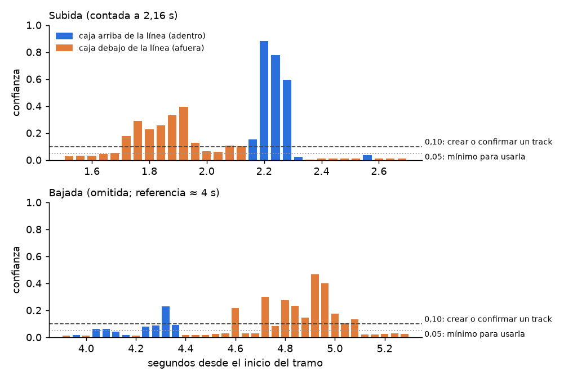

# Caso de detección · bajada omitida en el ensayo de oficina (0–6 s)

**Qué pasa.** En el tramo de 0–6 s del clip de oficina, una persona entra (subida, ≈ 2 s) y vuelve a salir (bajada, ≈ 4 s). El sistema cuenta la subida a 2,16 s, pero **no cuenta la bajada**. El panel termina con 1 pasajero (5 %) en lugar de 0.

**Por qué pasa.** Al salir, la persona cruza la línea en momentos en que el detector la ve con muy poca confianza. El rastreador nunca llega a seguirla del lado de adentro. La primera vez que la sigue, a 4,92 s, ya está afuera y con un ID nuevo. Sin un lado de origen confirmado, la regla de conteo no emite el evento.

No es un defecto de la API ni del panel: el código de `vision` sin modificar da el mismo resultado.

## Configuración

Es la configuración guardada con la predicción de 0–6 s (`evaluation/results/oficina-00-06-prediccion.config.json`):

- **Clip:** `data/raw/oficina.mp4`, SHA-256 `02666c2e…15fc95`, cuadrante superior derecho (`--recorte 228,2,222,176`).
- **Línea:** horizontal en y = 90 del recorte. Arriba es adentro, así que de abajo hacia arriba es `subida`.
- **Detector:** `yolo11n.pt` (base COCO, sin ajustar), `--conf 0.05`, en CPU.
- **Rastreador:** `vision/bytetrack-cenital.yaml`. Los valores que importan acá: `track_high_thresh 0.1`, `new_track_thresh 0.1` y `track_low_thresh 0.05`.
- **Conteo:** el centro de la caja decide el lado, con `--margen 5` px y `--confirmacion 2` cuadros.

## Lo observado

| Plataforma | Subida | Bajada | Ocupación final |
|---|---|---|---|
| macOS, Apple M4 (compañero, `dd5a19a`) | 2,16 s, ID 1 | 4,60 s, ID 5 | 0 pasajeros |
| Linux x86, Intel Xeon (Claude, 7 nov.) | 2,16 s, ID 1 | **omitida** | 1 pasajero (5 %) |
| Windows 11, AMD (Álvaro, 7 nov., ejecución `20261107-194239-470039`) | 2,16 s, ID 1 | **omitida** | 1 pasajero (5 %) |

En Linux, dos ejecuciones desde el panel y una por terminal dieron el mismo JSON. La prueba `test_ensayo_de_oficina_sigue_dentro_de_la_tolerancia_de_la_referencia_manual` falla en Linux por esta omisión. Las predicciones y la configuración están en [`ejecuciones/`](ejecuciones/).


`cuadros.png` (no se publica: son cuadros de un video de terceros sin licencia abierta; copia local en `runs/cuadros-oficina-bajada-omitida.png`): un cuadro de cada tres. Las cajas son los tracks que entrega el rastreador.

- **Arriba (subida):** el track 1 aparece debajo de la línea a 1,92 s, la cruza y a 2,28 s se marca en verde.
- **Abajo (bajada):** entre 4,32 y 4,80 s la persona atraviesa la línea **sin ninguna caja**. Recién a 4,92 s aparece el ID 9, ya debajo.

## Por qué pasa, paso a paso



[`confianza.png`](confianza.png) muestra la mayor confianza de "persona" que da `yolo11n.pt` en cada cuadro del recorte, sin rastreador y sin umbral. El color indica el lado de la línea donde cae el centro de esa caja. Datos en [`confianza.json`](confianza.json), generados con [`medir_confianza.py`](medir_confianza.py).

**La subida funciona porque hay detecciones claras de los dos lados.** Debajo de la línea, de 1,72 a 1,92 s, la confianza está entre 0,18 y 0,39. Supera 0,10 en varios cuadros seguidos, así que nace el track 1 y queda confirmado del lado de afuera. Durante el cruce, de 2,00 a 2,16 s, baja a 0,06–0,15, pero ByteTrack la mantiene con el mismo ID: acepta detecciones débiles, hasta 0,05, para tracks que ya existen. Arriba, de 2,20 a 2,28 s, sube a 0,60–0,88. Hay dos cuadros confirmados de cada lado y el mismo ID, así que se emite la subida.

**La bajada falla en tres pasos:**

1. **Arriba de la línea nunca nace un track.** Antes de salir, de 4,04 a 4,36 s, la persona está adentro, pero vista desde arriba casi siempre queda por debajo de 0,10: 0,06, 0,08, 0,09. Solo el cuadro de 4,32 s llega a 0,23. Un track nuevo necesita superar `new_track_thresh` (0,10) y otro cuadro fuerte que lo confirme. El cuadro siguiente da 0,093 y no alcanza, así que ByteTrack descarta ese track sin entregarlo.
2. **Mientras cruza, el detector no la ve.** De 4,40 a 4,56 s, justo sobre la línea, la confianza cae a 0,02–0,03. Está por debajo incluso del mínimo de 0,05, así que no hay ninguna detección para seguir.
3. **Cuando reaparece, ya está afuera.** A partir de 4,60 s vuelve a haber detecciones, todas debajo de la línea (y ≈ 111–158). El primer track que el rastreador confirma es el 9, ya del lado de afuera. Para la regla de conteo, el primer lado de un track no cuenta: aparecer junto a la línea no alcanza. Por eso no hay bajada.

Lo medido es el mecanismo de los tres pasos: la confianza del detector cae justo en la puerta y la regla de conteo pierde el lado de origen. **Por qué el detector ve tan poco a la persona en esos cuadros no está demostrado.** Una hipótesis es el punto de vista cenital, poco común en los datos con que se entrenó `yolo11n.pt`, pero aquí no se midió la composición de esos datos. La configuración del rastreador ya se había calibrado para aceptar confianzas bajas, y en este cruce no alcanza. Un detector de cabezas externo, probado aparte, sí detecta a la persona en estos cuadros ([comparación](../comparacion-repositorios/README.md)). Eso muestra que el cruce es detectable, no cuál es la causa.

**Por qué en macOS sí se contaba (sin confirmar).** Varias confianzas del paso 1 quedan a centésimas del umbral: 0,081, 0,088 y 0,093 contra 0,10. Una **hipótesis** es que diferencias numéricas mínimas entre CPUs (ARM contra x86) o bibliotecas muevan un cuadro por encima o por debajo de 0,10, y eso decida si el track de adentro llega a confirmarse. No está medido en la Mac: para confirmarlo, el compañero puede ejecutar `medir_confianza.py` allá y comparar los valores entre 4,04 y 4,60 s. En cualquier caso, un resultado que cambia según el procesador indica que esta configuración está en el límite y no es robusta.

## Efecto en la ocupación

Con capacidad 20 y carga inicial 0, `POST /ocupacion` sobre la predicción da 1 subida, 0 bajadas, 1 pasajero y 5 %, sin avisos. Ver [`ocupacion-api.json`](ocupacion-api.json). El error no genera ningún aviso porque una bajada omitida nunca deja el conteo en negativo: el pasajero "fantasma" queda a bordo hasta el final del recorrido. En un bus real estos errores se acumulan parada tras parada.

## Cómo reproducirlo

Desde la raíz, con el clip, `yolo11n.pt` y las dependencias de `vision/requirements.txt`:

```sh
python -m vision.pipeline --video data/raw/oficina.mp4 --inicio 0 --fin 6 --recorte 228,2,222,176 \
  --linea 0,90,221,90 --interior arriba --rastreador vision/bytetrack-cenital.yaml --conf 0.05 \
  --confirmacion 2 --dispositivo cpu --pesos yolo11n.pt --salida runs/caso.json --video-anotado runs/caso.mp4
python docs/casos-deteccion/oficina-bajada-omitida/medir_confianza.py runs/confianza.json
```

También se puede reproducir desde el panel: **Predicción automática del video de oficina → Procesar clip de oficina (0–6 s)**.

## Opciones (sin aplicar)

No se cambió ningún parámetro: la decisión es del módulo de visión.

1. **Detector ajustado** (`runs/oficina-ajuste/oficina-ajustado.pt`, con `python -m vision.train`), con el rastreador por defecto. Según [su documentación](../../../vision/ajuste-detector.md), cuenta los 20 cruces del video completo. Pero se entrenó con esa misma grabación, así que no prueba que generalice.
2. **Bajar `new_track_thresh` o `conf`.** Recuperaría este cruce, pero aumenta los falsos positivos. Además, calibrarlo sobre el mismo clip sería ajustar el resultado a la prueba.
3. **Mostrarlo en la defensa** como ejemplo de pérdida de detección y cambio de ID, con `cuadros.png` (local) y [`confianza.png`](confianza.png).

## Revisión del tramo corto (8 nov., noche, Claude)

Pregunta de Álvaro: ¿la demo omite la bajada porque el clip es corto o porque el recorte la excluye?

**Respuesta: no. El tramo y el recorte incluyen los dos cruces; el fallo es de detección.**

- **Duraciones:**
  - el video original `data/raw/oficina.mp4` dura 52,64 s (1316 cuadros, 25 FPS, 450×360);
  - la demo usa **ese mismo archivo**, sin copia recortada, con `--inicio 0 --fin 6` de la configuración guardada `evaluation/results/oficina-00-06-prediccion.config.json`, es decir, 150 cuadros.
- **No hay un límite que obligue al tramo corto:** el único límite de la API es el tiempo máximo de 10 min, y el video completo se procesa en menos de 2 min en CPU. Los 6 s son una elección del ensayo de demo, el primer par entrada-salida.
- **Los dos movimientos están dentro del tramo y del recorte `228,2,222,176`:**
  - la **subida** cruza la línea y = 90 entre 2,00 y 2,20 s;
  - la **bajada** se ve arriba de la línea a 4,52 s, sobre ella a 4,64 s y debajo a 4,76 s;
  - la referencia completa (`data/annotations/oficina-cruces.json`) marca 2,16 s (subida) y 4,68 s (bajada);
  - comprobado con cuadros del video original, con la línea dibujada.
- **Con el video completo tampoco se cuenta:** en la ejecución de la tarea 11 (Linux), los únicos eventos antes de los 10 s son la subida a 2,16 s; la bajada de 4,68 s falta igual. Usar un tramo más largo no la recupera.
- **Causa:** la confianza del detector cerca de la puerta (`confianza.json`: 0,02–0,09 entre 4,40 y 4,68 s), tal como se describe arriba.
- **El test que falla es correcto:** la bajada existe y cruza la línea configurada. **No se cambió su expectativa ni el tramo de la demo.**

**Estado en la entrega (8 nov., noche):** es una **limitación confirmada de detección y seguimiento**. El test que la cubre (`test_ensayo_de_oficina_…`) falla por este defecto conocido, que se decidió conservar visible: no se cambió el tramo, ni la expectativa, ni el umbral global de confianza (bajarlo sin evaluar podría sumar detecciones falsas).
